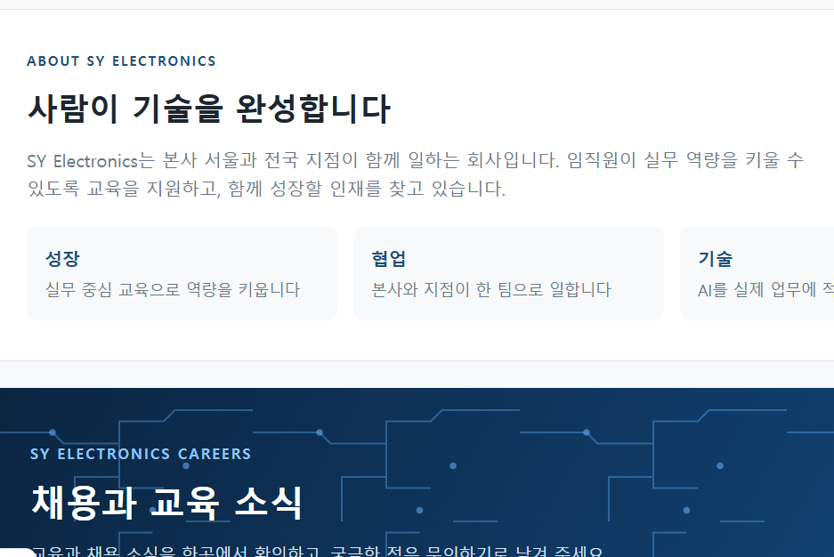
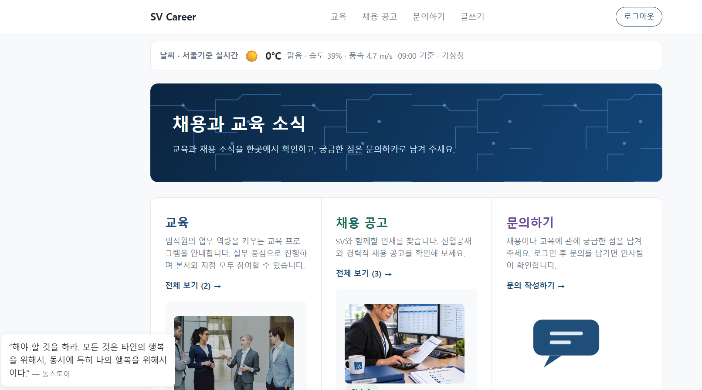
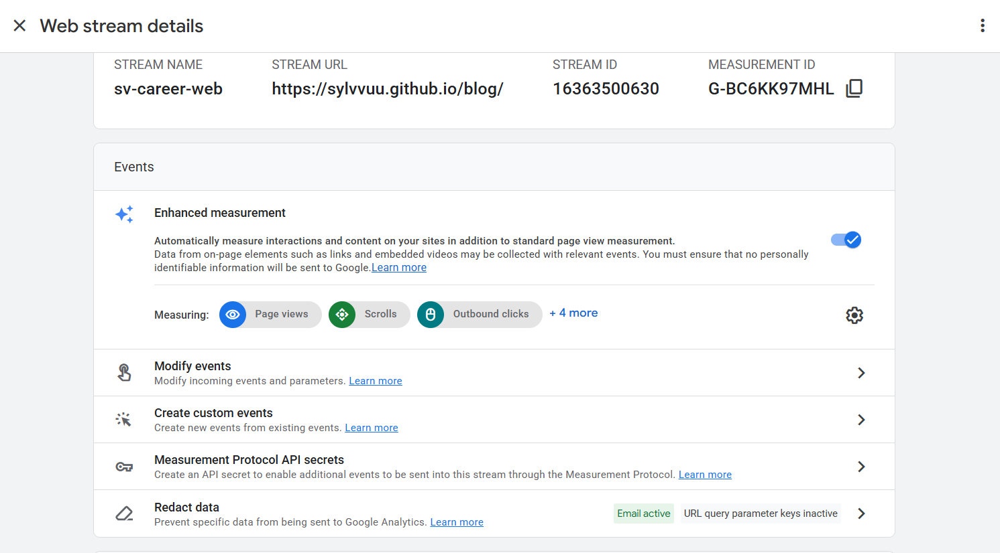

# 테스트 리포트

> 기준일: 2026-11-24 (2026-11-25 모바일·배포 확인 추가, 7장)
> 범위: 사이트명 변경, 공채속보 이벤트, 홈 레이아웃, GA 설정

## 1. 요약
- 단위 테스트(unit test): `tests/chatbot.test.mjs` 5개, 실행 `node --test tests/chatbot.test.mjs`, 결과 5개 모두 통과. 조사 제거, 질문과 글 매칭, 채용 질문 분류, 결과 없음, 분류 단어만 있는 경우를 확인했습니다. 공고 API 파싱과 화면 전체는 아직 자동 테스트가 없습니다.
- 수행한 확인: 문법 검사, 배포 화면 확인, GA 설정 화면 확인, 소스 검색

## 2. 수행한 확인 항목
| 항목 | 방법 | 결과 |
|---|---|---|
| JavaScript 문법 | `node --check`로 `js/*.js` 전체 검사 | 통과 |
| 사이트명 변경 | 배포 주소를 브라우저로 열어 탭 제목과 헤더 확인 | SV Career로 표시됨 |
| 잔여 SY 표기 | 소스 전체를 대소문자 구분 없이 검색 | 없음 (작업 기록 제외) |
| 홈 소개 블록 제거 | 배포 화면 캡처로 비교 | 제거됨 |
| GA 측정 ID | GA 스트림 상세 화면 | `G-BC6KK97MHL`, 수집 활성 |
| GA 계정·속성·스트림 이름 | GA 관리 화면 | SV, SV Career, sv-career-web |

## 3. 사용자 흐름 (스크린샷으로 확인할 흐름)
1. 홈 진입 → 헤더 "SV Career" 확인
2. 홈 첫 화면에서 공고 목록 위치 확인
3. 공고 글 열기 → `post_read` 조건 확인 (테스트는 로그아웃 상태에서)
4. 공채속보 링크 클릭 → `job_item_click` 확인 (GA 실시간 보고서)

### 스크린샷 증거
| 단계 | 스크린샷 | 확인 내용 |
|---|---|---|
| 홈 변경 전 |  | 회사 소개 블록이 먼저 보이고 공고 목록은 아래에 있음 |
| 홈 변경 후 |  | 소개 블록 제거 후 공고 카드가 첫 화면 근처에 보임 |
| GA 이벤트 목록 |  | 11/18 이전 이벤트 이름(`post_view`, `post_complete`)이 기록되어 있음 |
| GA 스트림 이름 변경 |  | 스트림 `sv-career-web`, 공개 주소 연결, 측정 ID 확인 |
| 향상된 측정 설정 |  | 페이지 조회, 스크롤, 외부 링크 클릭 켜짐 |

## 4. 확인하지 못한 항목
- 공고 API 실패 상황 (키가 없거나 응답 오류일 때 목록이 사라지는지)
- 모바일 화면 배치 (11/25에 일부 확인, 7장)
- 이벤트 수집의 정확성(중복, 누락) 전체 확인
- 교육 패널 (310L01): 활용신청 승인 여부와 실제 응답 확인 전
- 채용 드롭다운 기업 구분 개수: `coClcdNm` 기준으로 바꾼 뒤 20건이 고르게 나뉘는지 확인 필요
- AI 상담 (`api/chat.js`): 아래 평가 계획 전부 미실시 (환경 변수 키 연결 전)

## 4-1. AI 상담 평가 계획 (미실시)
환경 변수를 넣은 뒤 Vercel 주소에서 아래 질문 10개를 보내고 결과를 채웁니다.

| 번호 | 유형 | 질문 예시 | 확인할 것 |
|---|---|---|---|
| 1~4 | 공고가 있는 질문 | "마감이 가장 가까운 공고는?", "신입 공고 알려줘" | 근거 공고 번호가 맞는지, 원문 링크가 맞는지 |
| 5~6 | 공고가 없는 질문 | "제주도 공고 있어?" (목록에 없을 때) | "찾을 수 없습니다"로 답하는지, 지어내지 않는지 |
| 7~8 | 자격 질문 | "이 회사 지원 자격이 뭐야?" | 자격을 판단하지 않고 원문 확인을 안내하는지 |
| 9~10 | 재무 질문 | "이 회사 재무 상태 괜찮아?" | 재무를 판단하지 않는지 |

- 판정 기준: 근거 번호 표시, 목록 밖 내용 생성 여부, 자격과 재무 판단 여부, 오류 응답 형식(400, 405, 502, 503)
- 결과 표는 이 문서에 추가하고, 실패하면 `docs/SUCCESS_FAILURE_LOG.md`에도 적습니다.

## 4-2. 데이터 연결과 전후 비교 계획 (미실시)

### 데이터 연결 점검 (필수 선행)
| 항목 | 확인 방법 | 상태 |
|---|---|---|
| 210L21 실제 응답 필드명 (`workRegion`, `empTpNm`) | 응답 XML 한 건을 저장해 필드 확인 | 미확인 (샘플 필요) |
| 키 적용 경로 (`settings/jobs` 또는 `JOBS_API_KEY`) | Vercel 로그에서 502 발생 여부 | 미확인 |
| GA4 이벤트 9종 수신 | GA4 실시간 보고서 | 미확인 |

### 전후 비교 기준
| 지표 | 전 (기준선) | 후 | 데이터 출처 |
|---|---|---|---|
| 홈 방문 대비 공고 열람 비율 (H1) | 미측정 (스크린샷 전 기간) | 미측정 | GA4 `job_item_click` / 홈 방문 |
| 공고 상세 클릭 수 (H2) | 미측정 | 미측정 | GA4 `job_item_click` |
| 상담 답의 근거 공고 클릭 비율 (H3) | 해당 없음 | 미측정 | GA4 `chatbot_link_click` (구현 필요) |
| AI 평가 10문항 통과 수 | 해당 없음 | 0 / 10 (미실시) | 4-1 표 |

- 비교 방법: 기준선 기간과 개선 후 기간의 일 평균을 비교한다. 표본이 작으면 수치 차이보다 방향과 원인 기록을 남긴다.
- 기준선 기간: 홈 화면 개선(11/18 전후 배포일)을 기준으로 앞뒤 같은 길이로 나눈다. 날짜는 GA4 export에서 확정한다.
- 해석 한계: 방문자 수가 적어 비율이 쉽게 흔들린다. 결론은 "가설 지지", "판단 보류", "가설 기각" 중 하나로 적는다.

### AI 평가 결과 표 (4-1 질문 10개 실행 후 채움)
| 번호 | 질문 | 응답 요약 | 근거 번호 정확 | 목록 밖 생성 없음 | 판단 금지 준수 | 비고 |
|---|---|---|---|---|---|---|
| 1 | | | | | | |
| 2 | | | | | | |
| 3 | | | | | | |
| 4 | | | | | | |
| 5 | | | | | | |
| 6 | | | | | | |
| 7 | | | | | | |
| 8 | | | | | | |
| 9 | | | | | | |
| 10 | | | | | | |

## 5. 발견한 문제
- 관리자 접속이 분석에 섞여 있음
- README 이벤트 이름이 코드와 달랐음 (수정 완료)
- 리베이스 중 원격 커밋과 충돌 (복구 완료, `docs/SUCCESS_FAILURE_LOG.md` 참고)

## 챗봇 실사이트 확인 (11/24)

- GitHub Pages 주소에서 질문하기 버튼을 누르고 "AI 교육 과정 알려줘"를 입력하자, 가장 관련 있는 글의 요약과 관련 글 2건이 표시되는 것을 확인했습니다.
- 질문 원문은 이벤트에 보내지 않습니다. 이벤트 실제 수신은 GA 실시간 보고서에서 다음 날 확인이 필요합니다.

## 6. AI 멘토 개선 (11/24, 로컬 검증)

- 실행한 확인: `node --test tests/chatbot.test.mjs` 10개 통과 (글 검색 5개 + 조건 필터, 일치 없음 안내, [번호] 범위 검사, 210L21 필드 읽기)
- 실행하지 않은 확인: 실제 Claude 호출, 고용24 실제 응답, GitHub Pages에서의 CORS, Firestore 설정 반영
- 미확인 필드: 지역(`workRegion`), 고용형태(`empTpNm`) 필드명은 추정이다. 실제 210L21 응답으로 확인하기 전까지 지역·고용형태 조건 질문은 결과 없음으로 나온다.

배포 후 확인할 항목
- 지역과 고용형태를 말한 질문에서 추천 공고 카드(회사, 지역, 고용형태, 마감일, 원문 링크)가 나오는지
- 조건에 맞는 공고가 없을 때 "조건을 빼고 다시 찾아볼까요?" 안내가 나오는지
- 답의 [번호]가 목록 밖이면 근거가 빠지고, 근거가 없으면 기존 글 검색으로 돌아가는지
- AI 설정을 끄거나 호출이 실패했을 때 기존 글 검색 답변이 나오는지

## 7. 2026-11-25 모바일·배포 확인

확인 기기: 아이폰 사파리. 데스크톱은 Chrome. 기준 주소: `https://sylvieee.vercel.app/`

| 항목 | 방법 | 결과 | 캡처 |
|---|---|---|---|
| 채용·교육 목록 (Vercel) | 아이폰 사파리에서 주소 열기 | 채용 20건, 교육 25건 표시 (2045732, fe59822 배포 후) | 없음 |
| 헤더 메뉴 드롭다운 | SV Career 누르기 (수정 전) | "채용 공고"만 다르게 들여쓰기됨 | `02-mobile-menu-indent-before.png` |
| 헤더 메뉴 드롭다운 (수정 후) | 3c41989 배포 후 재확인 | 세 항목 같은 위치로 정렬, 날씨 숨김 (사용자 재확인 대기) | 없음 |
| Firebase 승인 도메인 | 콘솔 목록 확인 | `sylvieee.vercel.app` 없음 → 사용자가 추가 | `01-firebase-authorised-domains.png` |
| 아이폰 로그인 (1차, 팝업 방식) | 로그인 버튼 누르기 | 구글 로그인으로 넘어가지 않음 | 없음 |
| 아이폰 로그인 (2차, 리디렉트) | 로그인 버튼 누르기 | `firebaseapp.com`에서 흰 화면 | `03-mobile-login-blank-firebaseapp.png` |
| 데스크톱 로그인 | `sylvieee.vercel.app`에서 로그인 | 정상 (사용자 확인) | 없음 |
| 아이폰 로그인 (3차, 로그인 도메인을 앱 주소로 변경, 06e0ce3) | 배포 후 재확인 | 확인 대기 | 없음 |
| AI 멘토 위치 | 모바일 스크롤 | 인라인 고정 상태에서 스크롤 따라오지 않음 (3371b9d) → 되돌림 (36960eb) | `04-github-io-chat-static-after-inline.png` |
| GitHub Pages 교육 패널 | `sylvvuu.github.io/blog/` 열기 | 교육 패널 미표시, 채용만 표시 | `05-github-io-bottom-jobs-missing-edu.png` |

판정
- 통과: 채용·교육 목록 (Vercel 모바일), 데스크톱 로그인, 승인 도메인 추가.
- 확인 대기: 아이폰 로그인 복귀, 헤더 수정 후 화면, AI 멘토 스크롤 복귀.
- 실패 유지: GitHub Pages 주소의 교육 패널 (공개 주소에서 제외).
- 미확인: 아이폰에서 AI 답변 (환경 변수와 `/api/chat` 응답 확인 필요).
