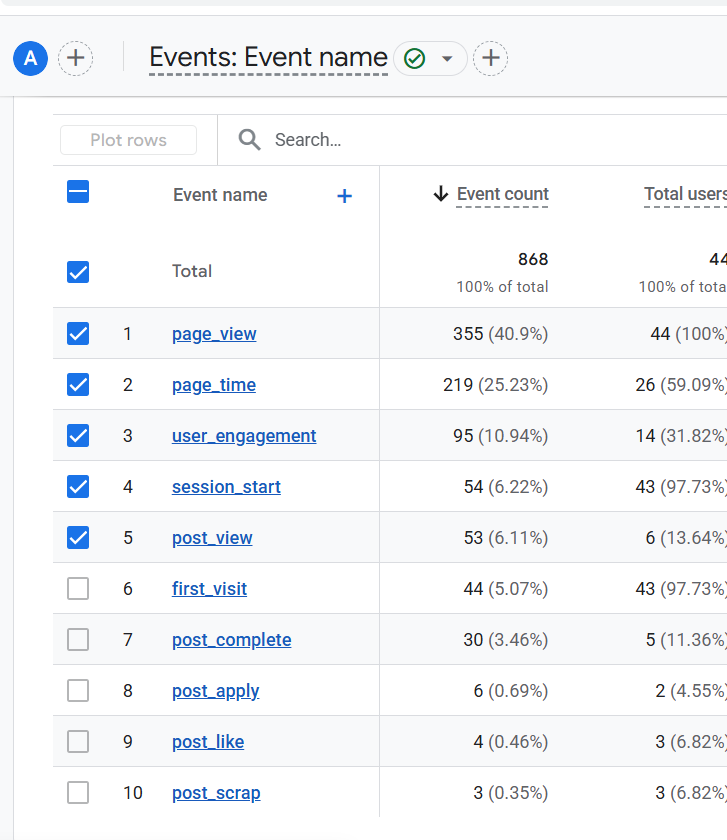
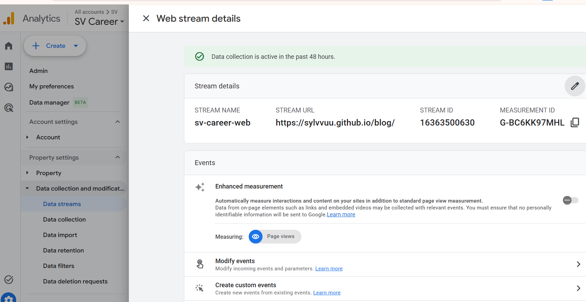

# 테스트 리포트

> 기준일: 2026-11-24
> 범위: 사이트명 변경, 공채속보 이벤트, 홈 레이아웃, GA 설정

## 1. 요약
- 단위 테스트(unit test): **없음**. 이 저장소에는 자동화된 테스트 코드가 아직 없습니다. 다음 단계에서 추가해야 합니다.
- 수행한 확인: 문법 검사, 배포 화면 확인, GA 설정 화면 확인, 소스 검색

## 2. 수행한 확인 항목
| 항목 | 방법 | 결과 |
|---|---|---|
| JavaScript 문법 | `node --check`로 `js/*.js` 전체 검사 | 통과 |
| 사이트명 변경 | 배포 주소를 브라우저로 열어 탭 제목과 헤더 확인 | SV Career로 표시됨 |
| 잔여 SY 표기 | 소스 전체를 대소문자 구분 없이 검색 | 없음 (작업 기록 제외) |
| 홈 소개 블록 제거 | 배포 화면 캡처로 비교 | 제거됨 |
| GA 측정 ID | GA 스트림 상세 화면 | `G-BC6KK97MHL`, 수집 활성 |
| GA 계정·속성·스트림 이름 | GA 관리 화면 | SV, SV Career, sv-career-web |

## 3. 사용자 흐름 (스크린샷으로 확인할 흐름)
1. 홈 진입 → 헤더 "SV Career" 확인
2. 홈 첫 화면에서 공고 목록 위치 확인
3. 공고 글 열기 → `post_read` 조건 확인 (테스트는 로그아웃 상태에서)
4. 공채속보 링크 클릭 → `job_item_click` 확인 (GA 실시간 보고서)

### 스크린샷 증거
| 단계 | 스크린샷 | 확인 내용 |
|---|---|---|
| 홈 변경 전 |  | 회사 소개 블록이 먼저 보이고 공고 목록은 아래에 있음 |
| 홈 변경 후 |  | 소개 블록 제거 후 공고 카드가 첫 화면 근처에 보임 |
| GA 이벤트 목록 |  | 11/18 이전 이벤트 이름(`post_view`, `post_complete`)이 기록되어 있음 |
| GA 스트림 이름 변경 |  | 스트림 `sv-career-web`, 공개 주소 연결, 측정 ID 확인 |
| 향상된 측정 설정 |  | 페이지 조회, 스크롤, 외부 링크 클릭 켜짐 |

## 4. 확인하지 못한 항목
- 공고 API 실패 상황 (키가 없거나 응답 오류일 때 목록이 사라지는지)
- 모바일 화면 배치
- 이벤트 수집의 정확성(중복, 누락) 전체 확인

## 5. 발견한 문제
- 관리자 접속이 분석에 섞여 있음
- README 이벤트 이름이 코드와 달랐음 (수정 완료)
- 리베이스 중 원격 커밋과 충돌 (복구 완료, `docs/SUCCESS_FAILURE_LOG.md` 참고)
